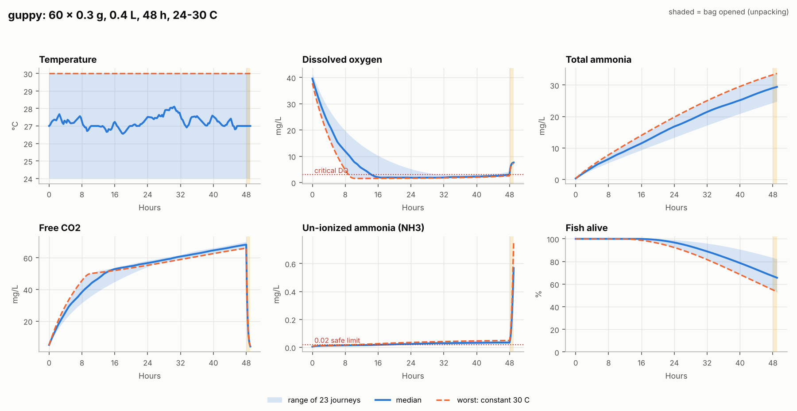
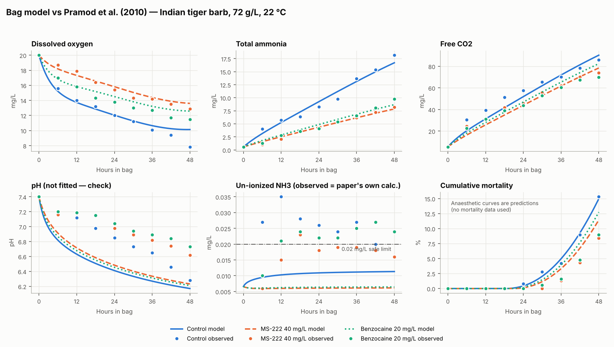

# Export simulator — transit survival in the sealed shipping bag

AquaSense component 4 (export management) · Owner: Samaraweera L A Y R · Project J26-SE-359

This package simulates what happens inside a sealed, oxygen-charged bag of live ornamental fish
during export: oxygen falls, ammonia and CO2 build up, pH drops, and fish start to die. It then
simulates **opening the bag**, when CO2 escapes, pH rebounds and ammonia becomes toxic.

On top of the model sits the **transit advisory** (`transit_sim/advisor.py`). Following the
supervisor's advice it does not just give a fish count: it explains how the oxygen is used and how
fast, how fast fish may die, which chemicals / add-ons to use and how much, the water chemistry,
temperature limits and how to unpack safely.

The advisory is available as a CLI, a demo web page (Streamlit), an HTTP API for the AquaSense
backend, and in the AquaSense mobile app (**Export planning** on the aquarium home screen).

It does not depend on, or change, any other AquaSense component.

## Quick start

```bash
cd export_simulator
python -m venv .venv && source .venv/bin/activate   # Windows: .venv\Scripts\activate
pip install -r requirements.txt

python -m transit_sim simulate --species guppy --count 60 --mass 0.3 \
    --water 0.4 --gas 1.2 --hours 48 --temp 26 --plot guppy_48h.png
python -m pytest -q
```

Example output:

```text
Predicted survival at arrival: 73.1% (guppy, 60 fish x 0.3 g in 0.4 L, 45 g/L, 48 h).
After unpacking: 71.7%.
Main cause of stress: carbon dioxide (70% of accumulated toxic load).
Oxygen in the water falls below the critical 3 mg/L after 17.8 h.
CO2 peaks at 69 mg/L (above 20 mg/L reduces blood O2 transport); pH falls to 6.26.
Toxic NH3 during transit stays at or below 0.030 mg/L because the low pH keeps ammonia ionized.
When the bag is opened, CO2 escapes and pH rises to 7.49: NH3 jumps to 0.509 mg/L (17x the transit level). WARNING: ...
```

### Transit advisory (packing plan)

```bash
python -m transit_sim advise --mass 0.3 --total 1000 --water 0.4 --gas 1.2 --hours 36 --temp-range 24 28
```

```text
PACKING PLAN
  Pack 48 fish per bag (36 g/L) with: fast 48 h + MS-222. 21 bags for 1000 fish. Expected survival
  after unpacking: 96.3% (worst case 95.2%) over 24-28 C.
  Without chemicals: 39 fish/bag -> 26 bags.
WHAT TO ADD       MS-222 40 mg/L = 16.0 mg per bag (0.4 L) ... with evidence + cautions
OXYGEN            use rate first 6 h / average, gas left, when water O2 hits critical
HOW FAST FISH DIE first deaths ~hour 29; alive at 6/12/24/36 h (median + worst); main cause
WATER CHEMISTRY   CO2, pH, total and toxic ammonia
TEMPERATURE       max safe constant temperature for this load
WATER AND OXYGEN  same bag split 1:1 ... 1:4 water:O2 -> fish per bag for each, suggested split
UNPACKING         pH rebound + NH3 spike, step-by-step unpacking
ALL OPTIONS       max fish/bag for every add-on combination
```

Three planning modes (CLI flags / API `mode` / the radio buttons in the demo / the selector in the app):

| Mode | The exporter gives | The simulator answers |
|---|---|---|
| `suggest` (default) | shipment + bag size | fish per bag, number of bags, add-ons and doses |
| `fixed_bags` (`--bags 20`) | total fish + number of bags | is that safe? which add-ons make it safe? if not, how many bags are needed |
| `check` (`--fish-per-bag 60 [--fasting 24] [--zeolite] [--anaesthetic ms222_40mgL]`) | their own packing | what happens to their fish (survival really drops when overpacked), compared with the safe plan |

```bash
python -m transit_sim advise --mass 0.3 --total 1000 --water 0.4 --gas 1.2 --hours 36 --temp-range 24 28 --fish-per-bag 60
# YOUR PACKING ... Expected survival after unpacking: 87.1% (worst case 80.2%)
# WARNING: Your packing is NOT safe ... With your add-ons the safe maximum is 37 fish per bag
```

A packing counts as safe when its fish per bag is within the hot-end maximum for its add-ons (the
same rule the optimiser uses), so all three modes agree with each other.

How the plan is chosen: every combination of fasting (24/48 h), zeolite and anaesthetic is tested;
for each, the largest fish count whose survival **after unpacking** stays above the target at the
**hot end** of the temperature range is found. An add-on is only recommended if it gains at least
5 % more fish per bag. The chosen plan is then re-run across the whole temperature range.

Water and oxygen (`advisory["bag_setup"]`): the exporter's bag size is kept and split between water
and oxygen gas in different ways (oxygen 1, 1.5, 2, 3 and 4 times the water, plus their own split).
For each split the same hot-end rule gives the most fish per bag. The suggested split uses as much of
the bag for water as possible while each litre of water still carries at least 95 % of the best fish
per litre, i.e. before the oxygen starts to run short. In a still bag the water volume, not the gas,
sets how many fish fit (guppy, 36 h, 24-28 C: about 90 fish per litre of water); in a 1.6 L bag,
0.53 L water + 1.07 L O2 holds 48 fish instead of 37 with 0.4 + 1.2, for the same total water.

### Demo UI (Streamlit)

```bash
streamlit run app/streamlit_app.py
```

Opens in the browser. Pick a planning mode and species on the left, fill in the shipment and press
**Plan shipment** (each run simulates every add-on combination, so inputs are applied together).
The answer comes first: a green or red verdict card with fish per bag, bags, survival and losses, a
packing checklist (including how to fill the bag) and the AI second opinion. Below it, **Key parameters
for this shipment** shows the conditions that decide survival, not just the fish count: packing
density, water + oxygen per bag, fasting, chemicals per bag, lowest oxygen, highest CO2, pH, ammonia at
unpacking, safe temperature and when deaths start, each marked against its safe limit. Details follow
as tabs with interactive charts: before you pack, survival, inside the bag (oxygen + water chemistry),
temperature, unpacking, compare options (add-ons and water : oxygen splits), and method & AI. Run it from `export_simulator/` so `.streamlit/config.toml` applies the AquaSense theme
(light and dark).

### HTTP API (for the AquaSense backend)

```bash
uvicorn transit_sim.api:app --port 8001
# optional shared secret (the Spring Boot backend sends it as X-Service-Key):
#   EXPORT_SIM_SERVICE_KEY=...   (PowerShell: $env:EXPORT_SIM_SERVICE_KEY = '...')
```

| Endpoint | Purpose |
|---|---|
| `GET /health` | liveness |
| `GET /v1/options` | species, anaesthetics, add-on catalogue |
| `POST /v1/advisory` | full advisory (snake_case body, see `AdvisoryIn`); headline numbers also in `X-Advisory-*` headers |
| `POST /v1/simulate` | one bag, one temperature |

Interactive docs at `http://localhost:8001/docs`.

### Commands

| Command | What it does |
|---|---|
| `python -m transit_sim advise ...` | Full transit advisory (packing plan, add-ons + doses, O2, deaths, unpacking) |
| `python -m transit_sim simulate ...` | Simulate one bag. `--json` for machine output, `--csv` for the time series, `--plot` for a PNG |
| `python -m transit_sim calibrate [--write]` | Re-fit to Pramod et al. 2010, write `reports/`; `--write` updates `config/` |
| `python -m transit_sim species` | List species configs |

Useful `simulate` options: `--temp-range 24 30` (uncertain temperature, see below),
`--temp 0:25,12:30,36:24` (known temperature profile), `--anaesthetic ms222_40mgL`,
`--zeolite 20`, `--starvation 12`, `--no-unpack`, `--kla 0.3` (more bag motion).

### Temperature ranges

Exporters usually know a band ("the hold will be 24–30 °C"), not the exact temperature. With
`--temp-range LOW HIGH` the simulator runs the low, middle and high constant cases plus `--samples`
(default 20) random, smooth profiles inside the band (new value every 6 h, reproducible with `--seed`),
and reports survival as worst / P10 / median / best.

```bash
python -m transit_sim simulate --species guppy --count 60 --mass 0.3 --water 0.4 --gas 1.2 \
    --hours 48 --temp-range 24 30 --plot range.png --csv runs.csv
```

```text
Temperature 24-30 C (23 simulated journeys):
  Survival at arrival:     54.9% (worst) | 63.3% (P10) | 67.0% (median) | 83.3% (best)
  Survival after unpacking: 53.3% (worst) | 61.7% (P10) | 65.6% (median) | 82.3% (best)
  Worst case: constant 30 C. Base packing decisions on the worst case / P10, not the median.
```

The packing optimiser will use the pessimistic end of this band.



### From Python

```python
from transit_sim import Shipment, Interventions, load_species, simulate, explain

sp = load_species("guppy")
sh = Shipment(fish_count=60, fish_mass_g=0.3, water_l=0.4, gas_l=1.2, duration_h=48, temperature_c=26)
res = simulate(sp, sh, Interventions(starvation_h=24))
print(res.summary["survival_at_arrival"], res.summary["main_driver"])
print(explain(res.summary, sp, sh))
```

## Layout

```text
export_simulator/
├── transit_sim/
│   ├── chemistry.py     O2/CO2 solubility, carbonate pH solver, Emerson NH3 equilibrium
│   ├── config.py        Species / Shipment / Interventions / Unpacking + YAML loading
│   ├── model.py         the ODE model, unpacking phase, summary
│   ├── explain.py       plain-language explanation
│   ├── uncertainty.py   temperature-range runs (worst / P10 / median / best)
│   ├── advisor.py       transit advisory: packing plan, add-ons + doses, O2, deaths, unpacking
│   ├── api.py           FastAPI service used by the Spring Boot backend
│   ├── calibration.py   fit + validation against Pramod 2010
│   ├── plots.py         report figures
│   └── cli.py
├── config/
│   ├── species/         tiger_barb.yaml (calibrated), guppy.yaml (inherits + overrides)
│   ├── bag.yaml         sealed-bag gas-transfer coefficient
│   └── interventions.yaml  calibrated anaesthetic effects
├── app/streamlit_app.py  demo UI
├── data/pramod2010/     digitised validation data + SOURCE.md
├── reports/             calibration figure, summary, example scenario
└── tests/
```

Every parameter in `config/` carries a `source`: a citation, `Calibrated to …`, or `ASSUMED`.

## The model

State per bag: dissolved O2, total ammonia (TAN), dissolved inorganic carbon (DIC), alkalinity,
O2 and CO2 in the headspace, ammonia held on zeolite, GUTS damage, cumulative hazard.
Integrated with `scipy.integrate.solve_ivp` (LSODA).

| Process | Equation (per hour) |
|---|---|
| O2 use | `o2_rate · (m / m_ref)^b · Q10^((T−T_ref)/10) · stress(t) · feeding · sedation · hypoxia(DO) · live biomass` |
| Handling stress | `stress(t) = 1 + stress_amp · e^(−t/τ)` |
| CO2 production | `RQ · O2 use` (mol/mol) |
| Ammonia excretion | same scaling as O2 use, with `tan_rate` |
| Gas exchange | `kLa · (H(T) · p_gas − C_water)` for O2 and CO2 (kLa_CO2 = 0.89 kLa_O2); headspace moles updated |
| pH | solved from DIC, alkalinity and TAN (carbonate + ammonia + water equilibria) |
| Toxic ammonia | `NH3 = TAN / (1 + 10^(pKa − pH))`, `pKa = 0.09018 + 2729.92 / T(K)` (Emerson 1975) |
| Mortality | GUTS-RED-SD: `dD/dt = kd (TU − D)`, `h = b · max(0, D − z)`, survival `= e^(−∫h)` |
| Toxic units | `TU = NH3/LC50 + CO2/co2_ref + max(0, DO_crit/DO − 1)` |
| Unpacking | headspace replaced by air, `kLa_open = 4 /h`; fish keep respiring |

Dead fish stop respiring. Decomposition is not modelled.

## Validation status

Calibrated and validated against **Pramod et al. (2010)** — tiger barb, 72 g/L, 22 °C, 48 h,
control + MS-222 + benzocaine. Full details: [`reports/calibration_summary.md`](reports/calibration_summary.md).



- DO, TAN and CO2 fit with NSE ≥ 0.92 in all three bags.
- Control mortality curve fits (15.0 % vs 15.3 %); anaesthetic mortality is **predicted** without
  using their mortality data: 11.4 % vs 8.4 % (MS-222), 12.7 % vs 9.0 % (benzocaine).
- pH is predicted, not fitted, and reads lower than the paper (their CO2 and pH disagree with each other).

## Assumptions and placeholders

| Item | Status | Replace with |
|---|---|---|
| Guppy parameters | Inherited from tiger barb, scaled by body mass (exponent −0.2) | Teo, Chen & Lee 1989; Teo & Chen 1993; own experiment |
| `q10 = 2`, `rq = 0.9`, `stress_tau_h = 4` | Literature-typical | Sensitivity analysis |
| `nh3_lc50` tiger barb = 1.0, `co2_ref = 100` | Normalisers | Species LC50 data (EPA ECOTOX) |
| Zeolite kinetics (0.05 L/g/h, 5 mg N/g) | **Placeholder** | Teo et al. 1989 full text |
| Feeding factors (+35 % O2, ×3 TAN when fed) | Rough literature values | Starvation trial |
| `kLa` sealed = 0.066 /h | Static lab bag | Measure / vary for moving boxes |
| `kLa_open` = 4 /h | Assumed | Unpacking measurements |
| Tris buffer, salt, 2-phenoxyethanol | Not modelled yet | — |

## AI correction layer (`transit_sim/ml/`)

The physics model gets most of the answer right but will be systematically off in real shipments
(bag motion, species differences, sedation, hotter-than-forecast days). The AI layer learns that
error from completed shipments and corrects it:

`corrected survival = expit( logit(physics survival) + AI correction )`

- **Model:** scikit-learn `GradientBoostingRegressor` (300 shallow trees, depth 2, learning rate 0.03,
  80 % subsampling) predicting the **residual** on the logit scale. Inputs: the shipment details
  (species, fish weight, fish/bag, density, water, oxygen ratio, trip length, temperature range,
  fasting, zeolite, anaesthetic) plus physics outputs (survival, lowest oxygen, highest CO2,
  ammonia at unpacking). Shipments are weighted by √(fish counted).
- **Data now: SIMULATED.** `ml/synthetic.py` builds a "pretend reality" — the simulator with hidden
  differences (guppies breathe 20 % faster, bags move so oxygen enters faster, sedated fish tolerate
  CO2 better, trips run up to 1 °C hotter than forecast, random handling stress, fish-by-fish counting
  noise) — and records shipments from it in the same CSV format real records will use
  (`data/shipments/README.md`).
- **Evaluation:** 600 training / 300 unseen test shipments; learning curve at 10–600 shipments,
  5 repeats each; compared with physics only and with AI alone (no physics).

| On unseen simulated shipments | Mean error | Safe/not-safe call correct |
|---|---|---|
| Physics only | 3.5 points | 95 % |
| Physics + AI correction | **1.6 points** | 96 % |
| AI alone (no physics) | 3.0 points | 92 % |

With only 10 shipments the hybrid already improves on physics (2.5 points) while AI alone is far worse
(16.8 points): the physics core is what makes the AI usable with little data. The AI's attention
(permutation importance) falls on low oxygen, MS-222/benzocaine and fish weight — the hidden
differences it was meant to discover.

```bash
python -m transit_sim ml train                     # simulated data (generated on first run)
python -m transit_sim ml train --data data/shipments/real_shipments.csv   # once real records exist
```

Reports: `reports/ml/` (summary, learning curve, predicted vs observed, feature importance).
The advisory shows the AI estimate as a labelled **second opinion**; packing decisions stay
physics-based until the AI is trained on real records.

## Running the whole export feature locally

1. Python service: `uvicorn transit_sim.api:app --port 8001` (from `export_simulator/`).
2. Backend: start Spring Boot as usual. It calls the service at `AQUASENSE_EXPORT_SIM_URL`
   (default `http://localhost:8001`); set `AQUASENSE_EXPORT_SIM_KEY` to the same value as
   `EXPORT_SIM_SERVICE_KEY` if you use one. Flyway adds the `export_advisories` table (V10).
3. App: open an aquarium → **Export planning** → **Plan a shipment**. Without a backend
   (development mode) the app shows a bundled sample advisory instead.

Backend endpoints (any member of the aquarium):

| Method | Path |
|---|---|
| POST | `/api/v1/facilities/{facilityId}/export-advisories` — plan a shipment (runs the simulator, saves it) |
| GET | `/api/v1/facilities/{facilityId}/export-advisories` — latest 50 plans |
| GET | `/api/v1/facilities/{facilityId}/export-advisories/{id}` — one plan with the full advisory |

## Novelty check and new species

`transit_sim/novelty.py` decides whether the AI second opinion has seen shipments like this one.
It reads past shipments from `data/shipments/real_shipments.csv`. Required columns are `species,
fish_mass_g, fish_per_bag, water_l, gas_l, duration_h, temp_max_c`. Optional columns are `fasting_h`,
`zeolite_g_per_l` and `anaesthetic`. If the file is missing, the check has no history.

- **Range check:** the shipment is flagged as new if its species, sedative or zeolite choice was never
  seen. It is also flagged if fish size, density, gas:water ratio, trip length, hottest temperature or
  fasting time is outside the recorded min-max.
- **Similar-shipment count:** a similar shipment has the same species, sedative and zeolite choice,
  size, density, gas:water and trip length within 25 %, temperature within 2 C and fasting within 12 h.

| Situation | `experience.level` / `ai_display` | Exporter sees |
|---|---|---|
| ≥ 5 similar shipments | `many` / `full` | physics + AI second opinion |
| 1–4 similar | `few` / `limited` | physics, AI marked "limited experience" |
| out of range or 0 similar | `new` / `hidden` | physics only, with a note that this is the first data point |

**New species.** Add `config/species/<name>.yaml` with `base: <similar species>`, and override any
parameters with published values. Such a species is marked `borrowed_from`. Until
`MIN_SPECIES_RECORDS` (10) real shipments of it are recorded, the advisor plans with oxygen use and
ammonia production raised by `rate_uncertainty` (default 30 %), so it packs fewer fish per bag. It
also widens the survival range, using −30 % as the best case. The reason for this margin is that
in-bag oxygen use was well below published respirometry values, so borrowed or literature values can
be off. The details are in `advisory["species_uncertainty"]`.

## Roadmap

1. ✅ Mechanistic bag simulator + calibration/validation (this package)
2. ✅ Packing optimiser + transit advisory, demo UI, API, backend module and app screens
3. ✅ ML correction layer (trained on simulated shipments; waiting for real records)
4. Arrival confirmation: logged temperature profile + alive/dead counts → compare, attribute, retrain
5. ✅ API for the Spring Boot backend / Flutter app (`transit_sim/api.py`)

## References

- Pramod P.K. et al. (2010) *N. Am. J. Aquaculture* 72:290–297. doi:10.1577/A09-063.1
- Emerson K. et al. (1975) *J. Fish. Res. Board Can.* 32:2379–2383
- Jager T. et al. (2011) General unified threshold model of survival (GUTS). *Environ. Sci. Technol.* 45:2529–2540
- Benson B.B. & Krause D. (1984) *Limnol. Oceanogr.* 29:620–632
- Weiss R.F. (1974) *Mar. Chem.* 2:203–215
- Plummer L.N. & Busenberg E. (1982) *Geochim. Cosmochim. Acta* 46:1011–1040
- Silva et al. (2023) guppy un-ionized ammonia LC50 (verify full citation)
